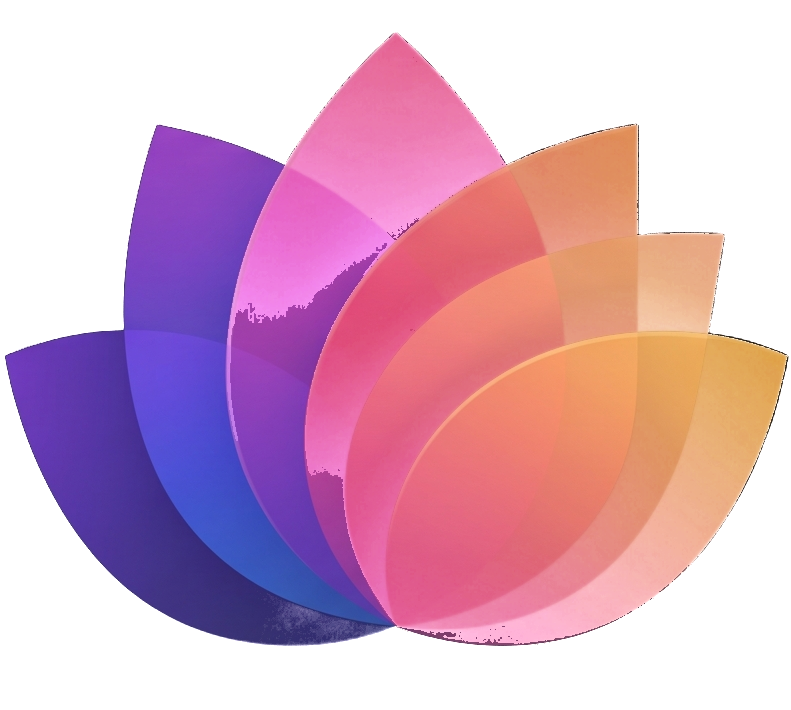

<div align="center">
  
  <h1>Wallzy</h1>
  <p>
    <strong>A fast, open-source desktop wallpaper downloader and manager written in Rust on GPUI.</strong>
  </p>
  <p>
    
    
    
    
    
  </p>
  <p>
    <a href="#features">Features</a> •
    <a href="#wallpaper-providers">Providers</a> •
    <a href="#getting-started">Getting Started</a> •
    <a href="#project-structure">Architecture</a> •
    <a href="#contributing">Contributing</a>
  </p>
</div>

---

## Overview

**Wallzy** combines a GPU-accelerated [GPUI](https://www.gpui.rs/) interface (`gpui-kit`) with pluggable wallpaper providers, viewport-aware HD preview caching, and native desktop integration across Windows, macOS, and Linux. It works immediately offline with procedurally generated curated artwork and local folder scanning, and automatically fetches fresh collections from enabled online providers on launch.

## Features

- **Smooth GPU-Accelerated Gallery** — Virtualized grid layout (`Compact`, `Comfortable`, and `Spacious` densities) with smooth interpolated scrolling, Light/Dark/System themes, and 5 accent color presets.
- **Smart Rolling HD Preview Cache** — Prefetches high-resolution previews for visible rows and adjacent modal items (`±1`) as you scroll, swaps cleanly over instant thumbnail placeholders with zero black flash, evicts far-away temporary files automatically as you scroll past, cleans up temporary HD files on exit, and reuses cached files when saving.
- **Fixed-Bounds Preview Inspector** — Crisp centered modal with `←` / `→` carousel navigation, color palette chips, clickable `#tags`, resolution/aspect-ratio specs, and instant desktop application.
- **7 Built-in Wallpaper Sources** — Combines curated offline artwork, local library scanning, and 5 live online feeds with auto-fetch on startup and manual refresh.
- **Powerful Filtering & Live Search** — Instant filtering by keyword (`name`, `author`, `#tags`), Category, Resolution (`1080p+`, `2K+`, `4K+`, `5K+`), Orientation, Source, and Sort order (`Featured`, `Trending`, `Newest`, `Highest Res`, `Name`).
- **Download Queue & Local Library** — Persistent favorites and download history, configurable save/library folders, retry support, and file-manager reveal.
- **Native Desktop Wallpaper Setter** — Apply any wallpaper directly with configurable fit modes (`Fill`, `Fit`, `Stretch`, `Center`, `Tile`).

## Wallpaper Providers

| Provider | Source | Coverage | API Key |
| :--- | :--- | :--- | :--- |
| **Wallzy Curated** | Built-in | Offline procedural artwork rendered cleanly on demand | Not required |
| **Local Library** | Disk folders | Scans download & user folders with real image dimensions | Not required |
| **Bing Daily** | Bing `HPImageArchive` | Daily UHD (`3840×2160`) photography | Not required |
| **Wallhaven** | Wallhaven v1 API | Community wallpapers (`toplist`, `date_added`, search) | Optional |
| **Reddit** | `r/wallpapers` + `r/MinimalWallpaper` | SFW community wallpaper posts | Not required |
| **Wikimedia Commons** | MediaWiki API | High-resolution Featured Pictures & CC imagery | Not required |
| **NASA Image Library** | NASA Images API | Public-domain astronomy, nebulae, and Earth photography | Not required |

## Keyboard Shortcuts

| Shortcut | Action |
| :--- | :--- |
| `Enter` *(in search)* | Query enabled online providers with current search text |
| `←` / `→` | Step to previous / next wallpaper inside the Preview Inspector |
| `Esc` | Close active filter dropdown or Preview Inspector modal |

## Getting Started

### Prerequisites

- **Rust toolchain**: Edition 2024 (`rustc 1.85+`)
- **`curl` in `PATH`**: Used for fetching online provider feeds, thumbnails, and downloads

### Build & Run

```bash
git clone https://github.com/PiyushAnand/wallzy.git
cd wallzy
cargo run
```

> Dependencies are compiled with `opt-level = 3` in `[profile.dev.package."*"]` so animations, scrolling, and image decoding run smoothly even in debug builds.

### Checks & Tests

```bash
cargo fmt --check
cargo clippy --all-targets -- -D warnings
cargo test
```

## Project Structure

```text
src/
├── main.rs                     # App entry point, asset bundle, and GPUI window setup
├── app.rs                      # Root WallzyApp state, async tasks, and viewport prefetch coordination
├── theme.rs                    # Light/Dark/System palettes, accent presets, and font tokens
├── assets/
│   └── wallzy_logo.png         # Application logo bundled in binary and README
├── models/                     # Domain structs, filters, settings, navigation, and downloads
│   ├── download.rs
│   ├── navigation.rs
│   ├── settings.rs
│   └── wallpaper.rs
├── providers/                  # Pluggable `WallpaperProvider` implementations
│   ├── bing.rs
│   ├── curated.rs
│   ├── local.rs
│   ├── nasa.rs
│   ├── reddit.rs
│   ├── wallhaven.rs
│   └── wikimedia.rs
├── services/                   # Core desktop, artwork, storage, caching, and download services
│   ├── artwork.rs              # Deterministic procedural PNG artwork generator
│   ├── downloader.rs           # Atomic file downloads with cached HD reuse
│   ├── preview_cache.rs        # Viewport-aware RollingHdCache and temp cache lifecycle
│   ├── storage.rs              # Persistent JSON settings and library state
│   └── wallpaper_setter.rs     # Native Windows / macOS / Linux desktop wallpaper integration
└── ui/                         # Modular GPUI views and components
    ├── card.rs
    ├── downloads_view.rs
    ├── filter_bar.rs
    ├── gallery.rs
    ├── preview_modal.rs
    ├── settings_view.rs
    ├── sidebar.rs
    └── topbar.rs
```

## Contributing

Contributions are warmly welcomed! See [CONTRIBUTING.md](CONTRIBUTING.md) for guidelines on adding new wallpaper providers, structuring UI components, and running checks before opening a PR.

## License

Licensed under the [MIT License](Cargo.toml).
